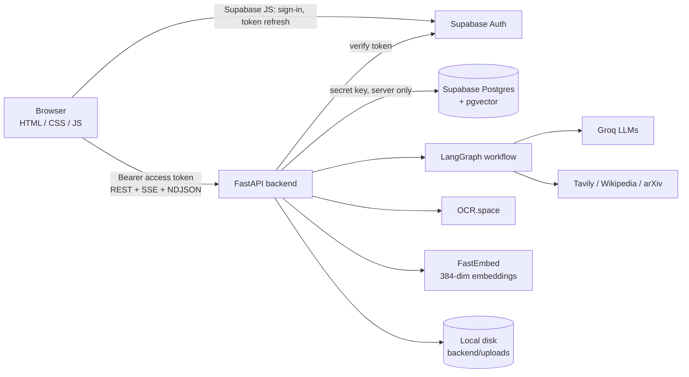
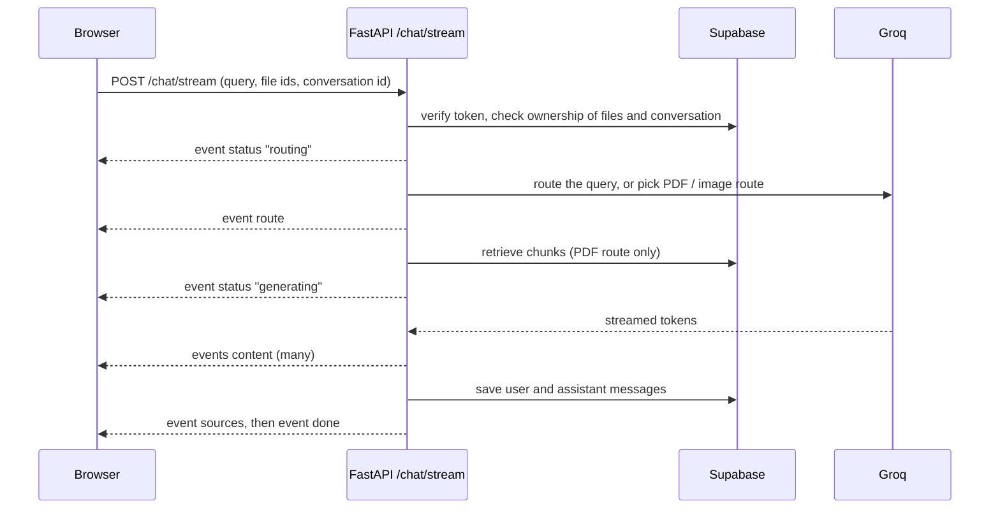
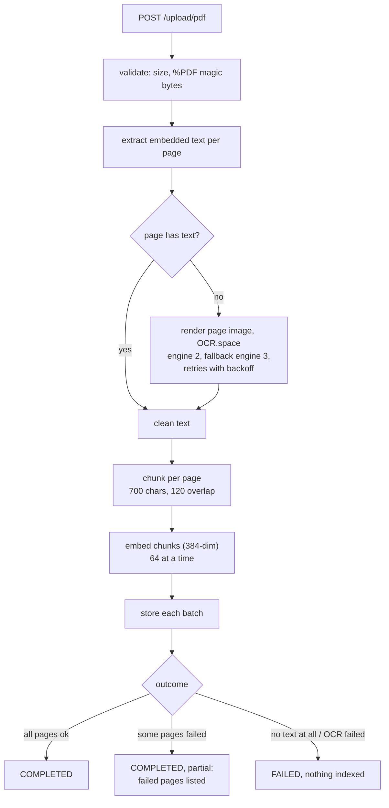

<h1 align="center">Cortexa AI</h1>

<p align="center"><em>The AI that knows where to look.</em></p>

<p align="center">
  
  
  
  
</p>
<p align="center">
  
  
  
  <a href="LICENSE"></a>
</p>

Cortexa AI (repository `cortexa-ai`) is a multi-agent assistant that routes every question to the right source (the
LLM itself, Wikipedia, the live web, arXiv, your uploaded PDFs or your images)
and streams back a grounded answer with sources and page citations. It has
voice input, saved chat history, user profiles and settings, and an admin panel
protected by server-side roles.

🧩 **Stack:** FastAPI · LangGraph / LangChain · Groq · Supabase (Auth, Postgres,
pgvector) · FastEmbed · OCR.space · plain HTML/CSS/JS frontend · Render.

---

## 📚 Contents

1. 🧭 [Overview](#1-overview)
2. ✨ [Features](#2-features)
3. 🧰 [Tech stack](#3-tech-stack)
4. 🏗️ [Architecture](#4-architecture)
5. 🔄 [Chat request flow](#5-chat-request-flow)
6. 🔀 [Routing with LangGraph](#6-routing-with-langgraph)
7. 📄 [PDF ingestion and OCR](#7-pdf-ingestion-and-ocr)
8. 🔎 [Retrieval pipeline](#8-retrieval-pipeline)
9. 📌 [Citations](#9-citations)
10. 🖼️ [Image understanding](#10-image-understanding)
11. 🎙️ [Voice input](#11-voice-input)
12. 🔐 [Authentication and sessions](#12-authentication-and-sessions)
13. 🛡️ [Roles and admin access](#13-roles-and-admin-access)
14. 🔒 [Security model](#14-security-model)
15. 🗃️ [Data model](#15-data-model)
16. 🧱 [Database migrations](#16-database-migrations)
17. 📁 [Project structure](#17-project-structure)
18. ✅ [Prerequisites](#18-prerequisites)
19. ⚙️ [Local setup](#19-local-setup)
20. 🔑 [Environment variables](#20-environment-variables)
21. ▶️ [Running locally](#21-running-locally)
22. 🖥️ [Frontend pages](#22-frontend-pages)
23. 📡 [API reference](#23-api-reference)
24. 📊 [Admin panel](#24-admin-panel)
25. 🧪 [Testing](#25-testing)
26. 📈 [RAG evaluation](#26-rag-evaluation)
27. 🚀 [Deploying on Render](#27-deploying-on-render)
28. 🛠️ [Troubleshooting](#28-troubleshooting)
29. ⚠️ [Known limitations](#29-known-limitations)
30. 🗺️ [Roadmap](#30-roadmap)

---

<a name="1-overview"></a>

## 🧭 1. Overview

You type (or speak) a question, optionally attaching PDFs or images. The
backend resolves every attachment by ID and checks that you own it. It then
picks a route:

- a PDF attached → **retrieval-augmented generation (RAG)** over that PDF;
- an image attached → **OCR plus a vision model**;
- otherwise an LLM router chooses **Direct**, **Wikipedia**, **Web (Tavily)** or
  **arXiv**.

The answer streams to the browser over Server-Sent Events, together with
progress stages and sources. Conversations, messages and uploads are stored in
Supabase per user.

<a name="2-features"></a>

## ✨ 2. Features

- 🔀 **Smart routing:** a structured-output LLM router picks the best tool for each
  text question.
- 📄 **Chat with your PDFs:** text PDFs, scanned PDFs (OCR) and mixed PDFs are
  supported. Hybrid retrieval combines dense and keyword search, and answers
  cite page numbers.
- 🔍 **Robust OCR:** per-page OCR, only for pages without embedded text. Engine
  fallback, retries with backoff, rate-limit spacing, and partial-success
  reporting when some pages fail.
- 🖼️ **Images:** OCR for text in the image and a vision model for everything else.
- 🎙️ **Voice input:** Whisper transcription with optional auto-send.
- ⚡ **Streaming UI:** live stages ("Choosing the best route", "Reading text in the
  image", "Writing the answer"), sources and retry.
- 📈 **Charts in answers:** when an answer compares numbers or shows a trend, the
  model can add a ```` ```chart ```` JSON block, drawn as a bar or line chart
  with tooltips, a legend and a table view (`frontend/charts.js`, no library).
  Only numbers from the retrieved information are allowed.
- 👤 **Accounts:** password, emailed one-time code and Google sign-in through
  Supabase Auth, a welcome email for new accounts, plus profile (display name)
  and settings (theme, voice language, auto-send, change password, log out
  everywhere, archive all chats).
- 📊 **Admin panel:** dashboard with charts (questions per day, sign-ups and
  uploads per day, questions by route), users, documents, images, activity,
  audit log and system health, all behind server-side role checks.
- 🌗 **Light/dark theme** and a responsive layout down to phone width.

<a name="3-tech-stack"></a>

## 🧰 3. Tech stack

| Layer | Technology |
|---|---|
| API | FastAPI 0.141, Uvicorn |
| Orchestration | LangGraph 1.2, LangChain Core |
| LLM | Groq `openai/gpt-oss-120b` (router, answers, RAG) |
| Vision | Groq `qwen/qwen3.8-27b` |
| Speech | Groq `whisper-large-v3-turbo` |
| Search tools | Tavily, Wikipedia API, arXiv |
| Embeddings | FastEmbed `sentence-transformers/all-MiniLM-L6-v2` (384 dimensions, English-focused; chosen to fit 512 MB hosting) |
| Vector store | Supabase Postgres + pgvector |
| Auth | Supabase Auth (supabase-js 2.117.3 in the browser, pinned with SRI) |
| OCR | OCR.space (engines 2 and 3) |
| PDF | PyMuPDF, pypdf |
| Frontend | Plain HTML, CSS and JavaScript, no build step |
| Hosting | Render (no Docker) |

Exact versions are pinned in [`backend/requirements.txt`](backend/requirements.txt).

<a name="4-architecture"></a>

## 🏗️ 4. Architecture



The browser only holds the public Supabase URL and publishable key, which it
gets from `GET /config`. The server-side secret key, the Groq, Tavily and
OCR.space keys, and every database write stay on the backend.

<a name="5-chat-request-flow"></a>

## 🔄 5. Chat request flow



On failure the stream ends with a generic `error` event. Internal details are
logged on the server and never sent to the client. If Groq's rate limit is hit
(the free tier allows about 8,000 tokens per minute, roughly 3 PDF questions),
the message says the AI service is busy and to try again in a few seconds.

**PDF questions use one LLM call.** The server retrieves the relevant chunks,
then streams an answer from the grounded PDF prompt (answer only from the
retrieved pages, otherwise say it isn't in the PDF). The general-purpose
answer prompt is not used for PDFs, so it can't add outside knowledge.

**Follow-up questions.** The last 6 messages are passed to the PDF prompt so
"explain that again" is understood, but only as context, never as a source of
facts. A short question that refers back ("and what is its time complexity?")
is searched together with the previous user question, because on its own it
has no topic words to search for.

<a name="6-routing-with-langgraph"></a>

## 🔀 6. Routing with LangGraph


Attachments take priority (`graph/nodes.py`). Text-only questions go to the
structured router in `graph/router.py`, which returns one of `DIRECT`,
`WIKIPEDIA`, `TAVILY` or `ARXIV` with a short reason.

<a name="7-pdf-ingestion-and-ocr"></a>

## 📄 7. PDF ingestion and OCR



- Only pages without embedded text are sent to OCR, and at most
  `MAX_OCR_PAGES` (50) per PDF; scanned pages beyond that are reported as
  not searchable.
- PDFs over `MAX_PDF_PAGES` (300) are rejected up front with a clear message.
- Chunks are embedded and stored 64 at a time, so memory stays flat and no
  single database request grows with the PDF. Measured locally: a 600-page
  PDF (2,400 chunks) peaked at about 310 MB for the whole process.
- Only `PDF_MAX_CONCURRENT` (1) PDF is indexed at a time; another upload
  waits and shows "Waiting for another PDF to finish".
- A page counts as `success`, `empty` (OCR worked but found no text) or `failed`.
- If embedding or storage fails, the document is rolled back, so no
  half-indexed document is left behind.
- If the file is deleted while it is being processed, the document is discarded.
- With `?stream=true` the upload returns NDJSON progress events (one per
  stage/page) followed by the result.

<a name="8-retrieval-pipeline"></a>

## 🔎 8. Retrieval pipeline

Implemented in `backend/rag/retrieval/` and run for every PDF question:

1. **Query transform:** classifies the query (specific, list or broad) and
   normalises it.
2. **Hybrid retrieval:** dense search through the `match_document_chunks` RPC
   (pgvector) plus keyword search through the `keyword_document_chunks` RPC,
   20 candidates each, merged.
3. **Rerank:** a lexical reranker keeps 5, 8 or 10 results depending on the
   query type. It uses generic stop words only, so it works for any PDF.
4. **Diversity selection:** avoids near-duplicate chunks.
5. **Context build:** adds neighbouring chunks (window 1), at most 8 to 10
   chunks or 6,000 characters, ordered by document position.

Nothing in the pipeline is specific to any document. The schema is fixed at
384 dimensions. Changing the embedding model means re-embedding every stored
chunk once:

```bash
cd backend
python -m scripts.reindex_embeddings            # counts only, changes nothing
python -m scripts.reindex_embeddings --apply    # rewrites document_chunks.embedding
```

<a name="9-citations"></a>

## 📌 9. Citations

Every chunk stores the page it came from. The context sent to the LLM labels
each chunk `[Source N | Page P | Chunk C]`, and the UI shows a source preview
with its page number. Pages that failed OCR are never cited, because nothing is
stored for them. This is covered by `tests/test_pdf_ocr.py` (see
`test_citations_carry_the_source_page`).

<a name="10-image-understanding"></a>

## 🖼️ 10. Image understanding

`POST /upload/image` stores the image (owner only). When it is attached to a
question, the backend runs OCR for visible text and the Groq vision model for
everything else, then answers from both. If one of them fails, the answer
still uses the other and says so.

<a name="11-voice-input"></a>

## 🎙️ 11. Voice input

The browser records audio and sends it to `POST /voice/transcribe` (Groq
Whisper). The transcript goes into the input box. If **Send automatically** is
on in Settings, it is sent straight away. The spoken language can be set in
Settings or left on automatic detection.

<a name="12-authentication-and-sessions"></a>

## 🔐 12. Authentication and sessions

- **Supabase Auth is the only credential store.** It handles email/password,
  Google OAuth, email confirmation and password reset. The app never stores
  or checks passwords itself.
- **One session manager:** the `Auth` object in [`frontend/common.js`](frontend/common.js)
  is shared by all pages. It has explicit states: `loading`, `signed-in`,
  `signed-out` and `error`.
  - While it is `loading`, pages show a neutral placeholder. They never flash
    the logged-out UI.
  - If the sign-in service can't be reached, the state becomes `error`, with a
    **Reconnect** button. The stored session is kept.
  - The state is re-synced when a page is restored from the Back/Forward cache.
- **API calls** send the access token as `Authorization: Bearer …`.
  - **401:** the client refreshes once and retries. Concurrent requests share
    one refresh. If the refresh is rejected, the session is ended and the
    sign-in dialog opens with "Your session has expired". If the auth server
    is unreachable, the session is kept and a temporary error is shown.
  - **403:** shows an access error and keeps the session.
  - **503:** shows a temporary error and keeps the session.
- **Backend verification** (`auth/supabase_auth.py`): an invalid or expired
  token gets `401`. If Supabase is unreachable, rate-limited or returns 5xx
  (after 3 attempts), the backend returns `503` with `Retry-After`, never a
  false "logged out".
- **Logout** signs out with Supabase and clears the local session. HTML pages
  are served with `Cache-Control: no-cache`.

### 🔑 Sign-in methods

The sign-in dialog (shared by every page, admins included) offers:

| Method | How it works |
|---|---|
| **Password** | `signInWithPassword`. Sign-up, email confirmation and "Forgot password?" work as before. |
| **Email code** | `signInWithOtp` sends a one-time code, `verifyOtp({ type: "email" })` checks it. |
| **Continue with Google** | Supabase Google OAuth. |

Switching between **Password** and **Email code** keeps the email you typed.
All three end in the same Supabase session, which the shared `Auth` manager
picks up through `onAuthStateChange`. Pages, the user menu and the
Back/Forward handling don't care which method was used.

Error messages keep problems apart: a network failure says the sign-in
service is unreachable and is never shown as a wrong password or code, a
`429` asks you to wait, and an email-sending failure says so.

### ✉️ Email code (OTP) sign-in

1. Choose **Email code**, enter your email and click **Email me a code**.
2. Supabase emails a numeric code. If the email is new, Supabase creates the
   account at this step, so the response is identical for registered and
   unknown addresses (no account enumeration).
3. Enter the code and click **Verify and sign in**. The dialog shows a
   10-minute countdown and a 60-second **Resend code** timer.

Rules:

- **Validity (10 minutes) is enforced by Supabase**, by the project setting
  "Email OTP expiration" = `600` seconds. The browser countdown is display
  only (its value comes from `EMAIL_OTP_EXPIRY_S` via `/config`) and never
  accepts or rejects a code; every code is checked by Supabase.
- **Resend** asks Supabase for a new code. Supabase keeps only the newest code
  for an account, so codes from earlier emails stop working.
- Supabase answers "incorrect" and "expired" with the same error
  (`otp_expired`), so the dialog says "incorrect or has expired" unless the
  countdown has run out, in which case it says the code expired.
- Buttons are disabled while a request is running, so double clicks send one
  request.
- Codes and email addresses are never written to the console or server logs.
- A code sign-in grants nothing extra: admin access still requires the rules
  in [§13](#13-roles-and-admin-access).

### ⚙️ Required Supabase settings

These are Dashboard settings; the app can't change or read them.

| Where (Supabase Dashboard) | Setting |
|---|---|
| Authentication → Sign In / Providers → Email | **Email OTP expiration: `600`** seconds (default is 3600). This also applies to the other email links and codes (sign-up confirmation, password reset). |
| Authentication → Emails → Templates → **Magic Link** | Include the code: `Your sign-in code is {{ .Token }}`. Existing confirmed users receive this template. |
| Authentication → Emails → Templates → **Confirm signup** | Also include `{{ .Token }}` (keep `{{ .ConfirmationURL }}` for password sign-ups). With "Confirm email" on, a **new** account requesting a code receives this template, not Magic Link. |
| Authentication → Sign In / Providers → Email | Keep **Confirm email** on. |
| Authentication → URL Configuration | Site URL plus redirect URLs for local (`http://127.0.0.1:8000/**`) and Render (`https://<your-app>.onrender.com/**`). |
| Authentication → Emails → SMTP Settings | A custom SMTP server for production. Supabase's built-in sender only delivers to your team's addresses and is limited to about 2 emails per hour. |
| Authentication → Sign In / Providers → Google | Unchanged; the Render URL must also be an authorized redirect in Google Cloud. |

Example template body (works for both templates):

```html
<h2>Your sign-in code</h2>
<p>Enter this code in Cortexa AI: <strong>{{ .Token }}</strong></p>
<p>It expires in 10 minutes. If you didn't request it, ignore this email.</p>
```

### 🧑 Guest chat

Visitors can chat without an account:

- On a visitor's first page view in a browser session the sign-in dialog
  opens; its **×** closes it and the visitor continues as a guest.
- Guests can send text questions (direct answers, Wikipedia, web search,
  arXiv). Uploading PDFs or images, voice input, profile and settings need
  an account: the server rejects them with `401` and the browser opens the
  sign-in dialog instead.
- Guest chats are stored like normal chats, with `user_id` empty and
  `conversations.guest_session_id` set to a random id the browser keeps in
  `localStorage` and sends as `X-Guest-Session`. That id is the only key to
  those chats; another guest id sees nothing (`404`).
- Each guest id and each client IP may send `GUEST_MESSAGES_PER_HOUR`
  messages per rolling hour (default 20; `0` turns guest chat off), so
  anonymous use can't exhaust the Groq quota. The counter is in memory and
  resets when the server restarts.
- A request with an invalid sign-in token is still a `401`; it is never
  treated as a guest.

**After sign-in, guest chats move to the account.** The browser calls
`POST /conversations/claim-guest` with its guest id. The server moves the
messages, then the conversations, to the signed-in user (so an interrupted
run can simply be repeated), the browser forgets the guest id, shows
"Your guest chats were saved to your account" and reopens the chat the
visitor was in. This works the same for every user and every sign-in method.

### 👋 Welcome email

New accounts get one welcome email ("Welcome to Cortexa AI"), whether
they signed up with a password, an email code or Google. Supabase Auth only
sends its own auth emails, so the backend sends this one through the provider
you configure (`WELCOME_EMAIL_PROVIDER`). With no provider configured, no
welcome email is sent. Accounts created during that time are recorded as
`SKIPPED` / `not_configured`, and still get the email on their next visit
once a provider is set up and the backend restarted, if the account is less
than 7 days old.

How it works ([`services/welcome_email.py`](backend/services/welcome_email.py)):

- **Trigger:** `/auth/me`, which every page calls once per signed-in user,
  queues a background task for the verified user. The email must be
  confirmed, so the address belongs to the account.
- **Only new accounts:** table `welcome_emails` has one row per account.
  Migration `20261011` adds a `SKIPPED` row for every account that already
  exists, and accounts older than 7 days without a row are skipped too. An
  existing user who signs in again never gets one, however they sign in.
- **At most once:** the backend claims the row with an `INSERT` before
  sending; parallel requests or servers lose on the primary key.
- **Failures:** if the provider reports that nothing was sent, the row is
  marked `FAILED` and retried on a later visit (10 minutes apart, 3 attempts).
  If the outcome is unknown (for example a crash mid-send), the row stays
  `SENDING` and is never resent. An account can miss its welcome email but
  never gets two. With Resend, an `Idempotency-Key` also stops repeats on
  Resend's side.
- **Logs** record the user id and a short outcome code only, never the
  address, the email body or credentials.

Providers (no new Python packages; set the keys on the server only):

| `WELCOME_EMAIL_PROVIDER` | Needs | Notes |
|---|---|---|
| `smtp` | `SMTP_HOST`, `SMTP_PORT` (587 STARTTLS / 465 SSL), `SMTP_USERNAME`, `SMTP_PASSWORD` | Any SMTP account, such as the one you configured for Supabase. **Blocked on Render's free instances**, which block outbound SMTP ports. |
| `resend` | `RESEND_API_KEY` | HTTPS API (free tier available). Sending to any address needs a verified domain. |
| `brevo` | `BREVO_API_KEY` | HTTPS API (free tier available). Needs a verified sender. |

All providers also need `EMAIL_FROM`. Set `APP_PUBLIC_URL` for the
**Start chatting** link, and `SUPPORT_EMAIL` or `SUPPORT_URL` to show a
support line (left out when empty).

<a name="13-roles-and-admin-access"></a>

## 🛡️ 13. Roles and admin access

Admins use the **same login page** as everyone else. A request is admin only
if **both** of these are true, checked on the backend for every `/admin/*`
endpoint:

1. the account's email is **confirmed** and listed in `ADMIN_EMAIL` (server
   config, comma-separated); and
2. `public.profiles.role = 'ADMIN'` for that user.

Notes:

- Normal users get `403`. A missing profile row means "not admin".
- If the role can't be read (a database outage), the request gets `503`, never
  a wrong yes or no.
- Supabase `app_metadata.role` is **ignored**.
- `ADMIN_EMAIL` is not a secret. It is an allowlist: changing the role in the
  database alone is not enough to become admin.
- There is **no admin password** anywhere in the app, `.env`, SQL or frontend.

To grant the role, an operator runs one of these on a trusted machine:

```bash
cd backend
python -m scripts.grant_admin            # show current state, change nothing
python -m scripts.grant_admin --grant    # set profiles.role = 'ADMIN' for ADMIN_EMAIL accounts
python -m scripts.grant_admin --revoke   # set it back to 'USER'
```

Or run this in the Supabase SQL editor:

```sql
update public.profiles set role = 'ADMIN'
where id = (select id from auth.users where email = '<admin email>');
```

The script never creates accounts or profile rows and never touches passwords.
Migration `20261010_protect_profile_role.sql` stops anyone from changing
`role` from the browser.

<a name="14-security-model"></a>

## 🔒 14. Security model

- **Every API route** except `/health` and `/config` requires a verified
  Supabase token. Admin routes also require the admin role.
- **No IDOR:** conversations, messages, documents, files and images are always
  filtered by the caller's `user_id`. Attachments are resolved by ID and
  ownership on the server, and the server never accepts a filesystem path from
  the browser.
- **Uploads:** size limits (`MAX_*_MB`), PDF magic-byte check, UUID-prefixed
  sanitized file names, and deletion confined to `backend/uploads/`.
- **Secrets stay on the server.** The browser only receives the publishable
  key. Email-provider keys (`SMTP_PASSWORD`, `RESEND_API_KEY`,
  `BREVO_API_KEY`) are read by the backend only. `.env` is git-ignored, and
  `.env.example` contains placeholders only.
- **Database:** Row Level Security stays enabled. The logging tables have RLS
  with no policies, so only the backend can use them.
- **Prompt injection:** RAG, OCR, vision and search prompts tell the model to
  treat retrieved or extracted text as untrusted content and not to follow
  instructions inside it.
- **Output:** markdown is HTML-escaped before rendering, and only `http(s)`
  links are rendered.
- **Headers:** `X-Content-Type-Options: nosniff`, `X-Frame-Options: DENY`,
  `Referrer-Policy: strict-origin-when-cross-origin`.
- **CORS:** off by default and enabled only for `ALLOWED_ORIGINS`.
- **Production** (`APP_ENV=production`) disables `/docs` and `/openapi.json`.
- **Timeouts** are set on all external calls: Groq (`GROQ_TIMEOUT_S`),
  OCR.space, Supabase HTTP and Wikipedia.
- **Errors:** unexpected errors return a generic message, and details go to the
  server log only. Logs never contain tokens or keys.

<a name="15-data-model"></a>

## 🗃️ 15. Data model

Tables in the `public` schema that the backend uses:

| Table | Purpose |
|---|---|
| `profiles` | display name, avatar, `role` (`USER` / `ADMIN`) |
| `conversations` | per-user chats (soft-archived on delete) |
| `messages` | user and assistant messages, route, sources |
| `files` | uploaded files (PDF / image) and their owner |
| `documents` | processed PDFs and their `processing_status` |
| `document_chunks` | chunk text, `page_number`, `chunk_index`, `embedding vector(384)` |
| `images` | image analysis records |
| `audio_files` | voice transcription records |
| `activity_logs` | voice use and failed requests/uploads (migration 20261008) |
| `admin_audit_log` | every destructive admin action (migration 20261008) |
| `welcome_emails` | one row per account: welcome email status, no address or content (migration 20261011) |

RPCs: `match_document_chunks` (vector search) and `keyword_document_chunks`
(keyword search).

<a name="16-database-migrations"></a>

## 🧱 16. Database migrations

SQL files in [`supabase/migrations/`](supabase/migrations/) are run once, in
order, in the Supabase SQL editor. Each is idempotent and forward-only.

| File | What it does |
|---|---|
| `20261008_activity_logging.sql` | `activity_logs` and `admin_audit_log` tables (RLS on, no policies) |
| `20261009_profiles_backend_access.sql` | lets the backend role read and write `profiles` |
| `20261010_protect_profile_role.sql` | trigger: `profiles.role` can't be changed (or set to anything but `USER` on insert) except by trusted server roles |
| `20261011_welcome_emails.sql` | `welcome_emails` table (RLS on, no policies) and a `SKIPPED` row for every existing account |
| `20261012_chunk_and_file_indexes.sql` | indexes on `document_chunks (document_id, chunk_index)` and `files (user_id)` for PDF search and per-user file lookups |

The app runs without `20261008`, but the admin panel then shows only data
from the core tables. Without `20261011`, no welcome email is sent.

<a name="17-project-structure"></a>

## 📁 17. Project structure

```
backend/
  main.py                 FastAPI app: pages, chat (SSE), uploads, voice, conversations
  account/routes.py       /profile/me (own profile and usage)
  admin/routes.py         /admin/* (admin only)
  auth/supabase_auth.py   token verification, admin rule, 401/403/503 mapping
  config/settings.py      environment configuration
  database/connection.py  shared Supabase client (thread-safe HTTP/1.1 pool)
  graph/                  LangGraph state, router, nodes, workflow
  agents/ tools/ prompts/ tool agents, external tools, prompt templates
  rag/
    ingestion/            PDF text extraction, OCR, cleaning
    chunking/             sentence-aware chunker
    embeddings/           FastEmbed model (384-dim)
    retrieval/            dense, keyword, hybrid, rerank, diversity, context
    query/                query classification and transform
    evaluation/           offline RAG evaluation tools and datasets
    pipeline.py           ingestion orchestration and outcomes
  services/               storage, file ownership, activity log, image analysis,
                          welcome email
  scripts/grant_admin.py  grant or revoke the admin role
  scripts/manual/         manual live-API smoke scripts (not unit tests)
  tests/                  unittest suites (all external services mocked)
frontend/
  index.html  app.js      chat
  profile.html profile.js profile
  settings.html settings.js settings
  admin.html  admin.js    admin panel
  about.html              about page
  auth-flows.js           sign-in logic without DOM: email code flow, auth error messages
  charts.js               bar and line charts for chat answers and the admin dashboard
  common.js               shared auth/session, sign-in dialog, API client, UI helpers
  style.css pages.css admin.css about.css
  assets/                 logo and icons
supabase/migrations/      SQL migrations (run in the Supabase SQL editor)
tests/frontend/           Node unit tests for frontend/auth-flows.js and charts.js
```

<a name="18-prerequisites"></a>

## ✅ 18. Prerequisites

- Python 3.13 (tested with 3.13.15)
- A Supabase project with Auth enabled and the tables and RPCs listed in
  [§15](#15-data-model)
- API keys for Groq, Tavily and OCR.space
- Optional: Google OAuth configured in Supabase Auth
- For email codes: the Supabase settings in [§12](#12-authentication-and-sessions)
- Optional, for welcome emails: an SMTP account or a Resend/Brevo API key
- Node.js 18+ only to run the frontend unit tests

<a name="19-local-setup"></a>

## ⚙️ 19. Local setup

```bash
cd backend
python -m venv .venv
.venv\Scripts\activate            # Windows
# source .venv/bin/activate       # macOS / Linux
pip install -r requirements.txt
copy .env.example .env            # Windows (macOS/Linux: cp .env.example .env)
```

Fill in `backend/.env` (see [§20](#20-environment-variables)), then run the
migrations from [§16](#16-database-migrations) in the Supabase SQL editor.

In Supabase Auth → URL configuration, add your site URL (for example
`http://127.0.0.1:8000`) and the production URL as redirect URLs. For email
codes, apply the Dashboard settings in
[§12](#12-authentication-and-sessions).

<a name="20-environment-variables"></a>

## 🔑 20. Environment variables

Defined in `backend/.env` (never committed). The template is
[`backend/.env.example`](backend/.env.example).

| Variable | Required | Description |
|---|---|---|
| `GROQ_API_KEY` | yes | Groq API key (LLM, vision, Whisper) |
| `TAVILY_API_KEY` | yes | Tavily web search |
| `SUPABASE_URL` | yes | `https://<project-ref>.supabase.co` |
| `SUPABASE_KEY` | yes | **server-side secret key**, backend only |
| `SUPABASE_PUBLISHABLE_KEY` | yes | public key sent to the browser for sign-in |
| `OCR_SPACE_API_KEY` | for scanned PDFs / images | OCR.space key |
| `ADMIN_EMAIL` | for admin | comma-separated admin allowlist (not a secret) |
| `APP_ENV` | no | `development` (default) or `production` |
| `APP_VERSION` | no | shown in the admin panel |
| `ALLOWED_ORIGINS` | no | CORS origins, only if the frontend is served elsewhere |
| `MAX_PDF_MB` / `MAX_IMAGE_MB` / `MAX_AUDIO_MB` | no | upload limits (25 / 10 / 25) |
| `GROQ_TIMEOUT_S` / `GROQ_MAX_RETRIES` | no | Groq request timeout and retries (60 / 2) |
| `GUEST_MESSAGES_PER_HOUR` | no | messages a guest (per guest id and per IP) may send per hour (20; `0` disables guest chat) |
| `CHAT_MESSAGES_PER_HOUR` / `PDF_UPLOADS_PER_HOUR` / `IMAGE_UPLOADS_PER_HOUR` / `VOICE_REQUESTS_PER_HOUR` | no | per-account hourly limits for signed-in users (60 / 10 / 20 / 30; `0` = no limit). Over the limit the API returns 429 with `Retry-After`. Counted in memory per process. |
| `MAX_PDF_PAGES` / `MAX_OCR_PAGES` / `PDF_MAX_CONCURRENT` | no | page cap per PDF, scanned pages sent to OCR per PDF, PDFs indexed at once (300 / 50 / 1) |
| `EMAIL_OTP_EXPIRY_S` / `EMAIL_OTP_RESEND_S` | no | countdowns in the code dialog (600 / 60). Display only: keep them equal to the Supabase settings, which are what enforce expiry and resend limits. |
| `WELCOME_EMAIL_PROVIDER` | no | `smtp`, `resend` or `brevo`; empty disables welcome emails |
| `EMAIL_FROM` | with a provider | sender, e.g. `Cortexa AI <no-reply@your-domain.com>` |
| `APP_PUBLIC_URL` | no | app link in the welcome email |
| `SUPPORT_EMAIL` / `SUPPORT_URL` | no | support line in the welcome email (omitted when empty) |
| `SMTP_HOST` / `SMTP_PORT` / `SMTP_USERNAME` / `SMTP_PASSWORD` | for `smtp` | SMTP server (port 587 STARTTLS or 465 SSL) |
| `RESEND_API_KEY` / `BREVO_API_KEY` | for `resend` / `brevo` | provider API key, **secret**, backend only |
| `OCR_SPACE_ENGINE` / `OCR_SPACE_FALLBACK_ENGINE` | no | OCR engines (2 / 3) |
| `OCR_SPACE_LANGUAGE` / `OCR_SPACE_FALLBACK_LANGUAGE` | no | OCR language (`auto`) |
| `OCR_MAX_ATTEMPTS` | no | attempts per page, alternating engines (4) |
| `OCR_RETRY_BASE_DELAY_S` / `OCR_RETRY_MAX_DELAY_S` | no | backoff (1.0 / 8.0) |
| `OCR_CONNECT_TIMEOUT_S` / `OCR_READ_TIMEOUT_S` | no | OCR timeouts (10 / 90) |
| `OCR_SPACE_MIN_INTERVAL_S` | no | spacing between OCR requests (0.5) |
| `OCR_RENDER_DPI` / `OCR_SPACE_MAX_UPLOAD_BYTES` | no | page rendering (150 / 1000000) |

<a name="21-running-locally"></a>

## ▶️ 21. Running locally

```bash
cd backend
uvicorn main:app --reload
```

On Windows with Smart App Control, `uvicorn` can fail with "DLL load failed
… Application Control policy" for `mmh3` or `_uuid_utils`. Use the launcher
instead:

```bash
cd backend
python -m scripts.run_local
```

It runs the same app on http://127.0.0.1:8000 (no auto-reload). Only if one
of those modules is blocked does it substitute a pure-Python stand-in: `mmh3`
is only used by FastEmbed's sparse models, which this app doesn't use, and
`uuid_utils` only creates LangChain trace ids. No Windows setting is changed.

| URL | Page |
|---|---|
| http://127.0.0.1:8000/ | Chat |
| http://127.0.0.1:8000/profile | Profile |
| http://127.0.0.1:8000/settings | Settings |
| http://127.0.0.1:8000/about | About |
| http://127.0.0.1:8000/admin | Admin panel (admins only) |
| http://127.0.0.1:8000/docs | API docs (development only) |

The first start downloads the embedding model, so it is slower.

<a name="22-frontend-pages"></a>

## 🖥️ 22. Frontend pages

Every page has the same header (Cortexa AI wordmark, "Powered by LangGraph ·
Groq" badge, Chat/About, connection status, date, theme and account menu) and
footer (AI-accuracy notice and "Made by Sonu Ray"). The badge, date and
footer side texts are hidden on narrow screens.

All pages share `auth-flows.js` (sign-in logic), `common.js` (session, sign-in
dialog, API client, user menu, toasts) and
`style.css` (design tokens, light/dark theme). Static assets are
cache-busted with `?v=<version>`.

| Page | What it does |
|---|---|
| Chat (`/`) | conversation sidebar, streaming answers, attachments (PDF/image) shown as preview cards (first PDF page or the image, a spinner while uploading, × to cancel or remove), voice, sources, retry |
| Profile (`/profile`) | display name, account details, usage counts |
| Settings (`/settings`) | theme, voice language and auto-send, sign-in method, change password, log out everywhere, archive all chats |
| About (`/about`) | overview, how a question is answered, routing, architecture, PDF pipeline, tech stack, security and creator |
| Admin (`/admin`) | dashboard, users, documents, images, activity, audit log, system health |

<a name="23-api-reference"></a>

## 📡 23. API reference

All endpoints except `/health`, `/config` and the HTML pages need
`Authorization: Bearer <Supabase access token>`. The conversation endpoints
and `/chat/stream` also accept a guest (`X-Guest-Session: <uuid>`, text only;
see [§12](#12-authentication-and-sessions)).

| Method | Path | Description |
|---|---|---|
| GET | `/health` | liveness check |
| GET | `/config` | public sign-in config (Supabase URL, publishable key, email-code countdown values) |
| GET | `/auth/me` | current user and admin flag (`null` if the role can't be read right now); queues the welcome email for a new account |
| POST | `/chat` | non-streaming chat |
| POST | `/chat/stream` | streaming chat (SSE: `status`, `route`, `content`, `sources`, `done`, `error`) |
| POST | `/upload/pdf` | upload and index a PDF (`?stream=true` for NDJSON progress) |
| POST | `/upload/image` | upload an image |
| GET | `/files/{file_id}/content` | download your own file |
| DELETE | `/files/{file_id}` | delete your own file |
| POST | `/voice/transcribe` | speech to text |
| GET | `/conversations` | list your conversations (signed in, or as a guest with `X-Guest-Session`) |
| POST | `/conversations/claim-guest` | move this browser's guest chats into the signed-in account |
| POST | `/conversations` | create a conversation |
| POST | `/conversations/archive-all` | archive all your conversations |
| GET | `/conversations/{id}/messages` | messages of your conversation |
| DELETE | `/conversations/{id}` | archive your conversation |
| GET / PATCH | `/profile/me` | your profile (only `full_name` can be changed) |
| GET | `/admin/me` | admin check |
| GET | `/admin/dashboard` | totals and recent activity |
| GET | `/admin/users`, `/admin/users/{id}` | users |
| DELETE | `/admin/users/{id}` | delete a user (audited) |
| GET | `/admin/activity`, `/admin/searches`, `/admin/chat-activity` | activity |
| DELETE | `/admin/activity/{log_id}` | delete an activity entry (audited) |
| GET | `/admin/audit-log` | admin audit trail |
| GET / DELETE | `/admin/documents`, `/admin/documents/{id}` | documents |
| GET / DELETE | `/admin/images`, `/admin/images/{id}` | images |
| GET | `/admin/system-health` | dependency checks |
| GET | `/admin/settings` | non-secret configuration (environment, models, limits) |

<a name="24-admin-panel"></a>

## 📊 24. Admin panel

`/admin` loads for everyone, but its data comes only from `/admin/*`
endpoints, and those endpoints enforce the admin rule from
[§13](#13-roles-and-admin-access). Other users see one of these gates instead:

- "Access denied" (403);
- "Please log in";
- "Can't check your access right now" (503).

Destructive actions ask for confirmation and are written to `admin_audit_log`.
Statistics come from the real tables; nothing is estimated or invented. The
dashboard charts show the last 14 days (UTC) from `GET /admin/dashboard`
(`trends`: questions, new users and uploads per day).

<a name="25-testing"></a>

## 🧪 25. Testing

```bash
cd backend
python -m unittest discover -s tests -v
```

```bash
node --test "tests/frontend/*.test.js"
```

The second command runs from the repository root and needs Node.js 18+.

| Suite | Covers |
|---|---|
| `tests/test_auth.py` | token verification, 401 vs 503 mapping, admin rule, `/auth/me` |
| `tests/test_security.py` | auth on every route, IDOR protection, admin 403/503 (including accounts that signed in with an email code), uploads, error hiding |
| `tests/test_welcome_email.py` | welcome email: new password / email-code / Google accounts, no email for existing users, concurrent and repeated requests, provider failures and retries, content, provider payloads, `/auth/me` trigger |
| `tests/frontend/auth-flows.test.js` | email code flow: request, verify, wrong and expired codes, 600 s countdown, resend and cooldown, rate limits, delivery and network errors, duplicate submissions, no codes in logs |
| `tests/test_pdf_ocr.py` | text / scanned / mixed PDFs, OCR retries and fallbacks, partial success, rollback, page citations, upload streaming |
| `tests/test_pdf_chat.py` | PDF questions in the chat stream: one grounded LLM call, "not found" without any LLM call, follow-up search text, history limit, image context, rate-limit message |
| `tests/test_guest_chat.py` | guest identity, invalid token never downgraded, uploads still need login, guest-only conversation filters, guest chat stream, per-guest/per-IP hourly limit, claiming guest chats (order, filters, empty, invalid id) |
| `tests/test_attachments_profile.py` | attachment ownership, profile endpoints |
| `tests/test_large_pdf_and_limits.py` | batched indexing of a 400-chunk PDF, rollback when a batch fails, page cap, waiting for a busy slot, OCR page cap, per-user hourly limits and 429 on chat and uploads |
| `tests/test_charts.py` | chart rules in the answer prompts, per-day dashboard counts (UTC days, empty days, invalid times) |
| `tests/frontend/charts.test.js` | chart spec validation (malformed JSON, caps on labels/series/text, number cleaning), axis ticks, number formatting |

Groq and OCR.space are always **mocked** (no credits used), and so are almost
all Supabase calls. Three tests are **read-only live checks** against the
Supabase project in `backend/.env`, so they need network access:

- an invalid token is rejected with 401;
- unknown file IDs return 404;
- the `ADMIN_EMAIL` account exists and is confirmed (skipped when
  `ADMIN_EMAIL` is empty).

None of them writes data. `scripts/manual/` holds optional live smoke scripts
that call the real APIs.

The email-code and welcome-email tests mock Supabase Auth and the email
providers. Real email delivery and Supabase's real code expiry are **not**
covered by automated tests. Check them by hand: request a code, wait past 10
minutes, and confirm Supabase rejects it.

<a name="26-rag-evaluation"></a>

## 📈 26. RAG evaluation

Offline evaluation tools live in `backend/rag/evaluation/`, with question
sets in `datasets/`:

```bash
cd backend
python -m rag.evaluation.evaluator --document-id <document id> --dataset my_pdf.json
```

[`PHASE14_REPORT.md`](backend/rag/evaluation/PHASE14_REPORT.md) records the
multilingual embedding benchmark. The model was later switched to
`all-MiniLM-L6-v2` so the app fits 512 MB hosting. On the same six evaluation
documents (full pipeline, recall@5): English stayed level (0.75 → 0.76 on
average), Hindi fell (0.76 → 0.58), and Odia stayed poor with either model
(0.11 → 0.13).

<a name="27-deploying-on-render"></a>

## 🚀 27. Deploying on Render

Create a **Web Service** (no Docker):

| Setting | Value |
|---|---|
| Root directory | `backend` |
| Build command | `pip install -r requirements.txt` |
| Start command | `uvicorn main:app --host 0.0.0.0 --port $PORT` |
| Environment | every variable from [§20](#20-environment-variables), plus `APP_ENV=production` |

Also:

- Add the Render URL to Supabase Auth → URL configuration (site URL and
  redirect URLs), and to Google OAuth if you use it.
- Render's **free** instances block outbound SMTP (ports 25, 465 and 587), so
  use `WELCOME_EMAIL_PROVIDER=resend` or `brevo` there, or a paid instance for
  `smtp`. Supabase's own auth emails are sent by Supabase and aren't
  affected.
- Uploaded files are stored under `backend/uploads/`. Render's disk is
  ephemeral, so attach a persistent disk at that path if files must survive
  redeploys. PDF chunks live in Supabase either way.
- The first request after a deploy is slower while the embedding model
  downloads.
- **Memory:** with `all-MiniLM-L6-v2` the app uses about 280 MB after start.
  Uploading a 128-page PDF (301 chunks) peaked at about 380 MB (measured on
  Windows), so Render's free 512 MB instance is enough. Two settings matter:
  chunks are embedded 8 at a time, and ONNX Runtime's CPU memory arena is off.
  With the arena on, the same upload peaked at about 800 MB and crashed the
  free instance. The vectors are identical either way.

<a name="28-troubleshooting"></a>

## 🛠️ 28. Troubleshooting

| Symptom | Cause / fix |
|---|---|
| "We couldn't reach the sign-in service" | Supabase Auth or `/config` unreachable. Your session is kept; use **Reconnect**. |
| "Your session has expired" | the refresh token was rejected. Sign in again. |
| Admin page says "Access denied" | the email isn't in `ADMIN_EMAIL`, isn't confirmed, or `profiles.role` isn't `ADMIN` (see [§13](#13-roles-and-admin-access)) |
| A PDF upload says some pages are unreadable | OCR failed for those pages after all retries. The rest is indexed. Re-upload later to retry. |
| "This PDF has no readable text" | the PDF has no embedded text and OCR found none (for example blank pages) |
| Backend can't start on Windows: `mmh3` or `_uuid_utils` "DLL load failed … Application Control policy" | Smart App Control blocks these native modules. Start with `python -m scripts.run_local` (see [§21](#21-running-locally)), which uses pure-Python stand-ins only for what is blocked. |
| `ValueError: GROQ_API_KEY is missing` | `backend/.env` isn't filled in |
| "That code is incorrect or has expired" | wrong code, a code from an older email, or more than 10 minutes passed. Request a new code and use the newest email. |
| "This code has expired" | the 10-minute countdown ran out. Click **Resend code**. |
| "Too many attempts" / resend timer | Supabase allows one code per address every 60 seconds, and limits requests per IP. Wait and retry. |
| The code email never arrives | check spam. Supabase's built-in sender only delivers to your project team's addresses (about 2 per hour), so configure custom SMTP in Supabase for real users. |
| The email has a link but no code | the template lacks `{{ .Token }}`. New accounts use **Confirm signup**, existing ones **Magic Link**; update both. |
| Codes still last an hour | "Email OTP expiration" in Supabase is still the default 3600; set it to 600. |
| No welcome email | no provider configured, `welcome_emails` migration not run, the account existed before the migration, or the provider failed. Check the `[WELCOME]` lines in the server log and the row's `status`/`reason`. |

<a name="29-known-limitations"></a>

## ⚠️ 29. Known limitations

- Uploads are stored on local disk (see [§27](#27-deploying-on-render)).
- The browser uses Supabase's implicit OAuth flow. PKCE would be stricter but
  needs email links opened in the same browser.
- Server logs include user queries for debugging. Treat logs as personal data.
- The RAG reranker is lexical, not a cross-encoder (see the Phase 14 report).
- The embedding model is English-focused, chosen to fit 512 MB hosting. Hindi
  and Odia PDFs retrieve noticeably worse; a 2 GB instance with
  `multilingual-e5-small` would be the upgrade path (see the Phase 14 report).
- The app can't read Supabase's code expiry or email templates, so the
  10-minute validity depends on the Dashboard setting in
  [§12](#12-authentication-and-sessions).
- The welcome email is at most once, not exactly once: a crash during sending
  can mean none is sent. It's sent the first time the new user opens the app
  with a confirmed email, not at the instant the account row is created.

<a name="30-roadmap"></a>

## 🗺️ 30. Roadmap

- Switch Supabase Auth to the PKCE flow.
- Move uploads to Supabase Storage.
- Add an automated browser test suite (Playwright) for the auth and session
  flows.
- Add query logging levels so production logs can omit user content.

---

## 📜 License

Released under the [MIT License](LICENSE). © 2026 Sonu Ray.
