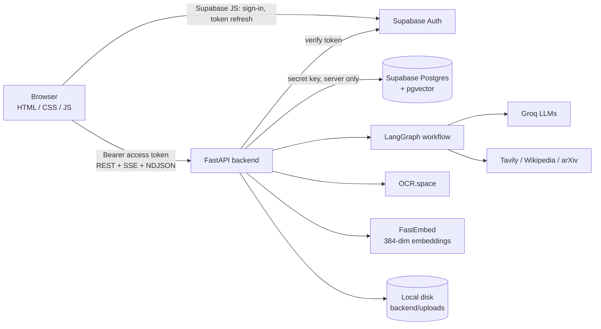
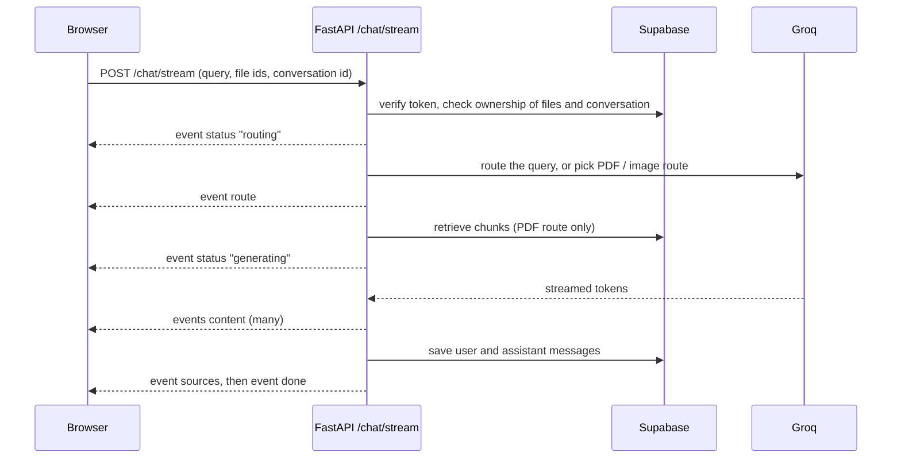
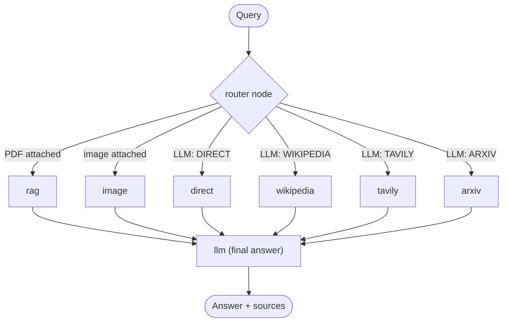
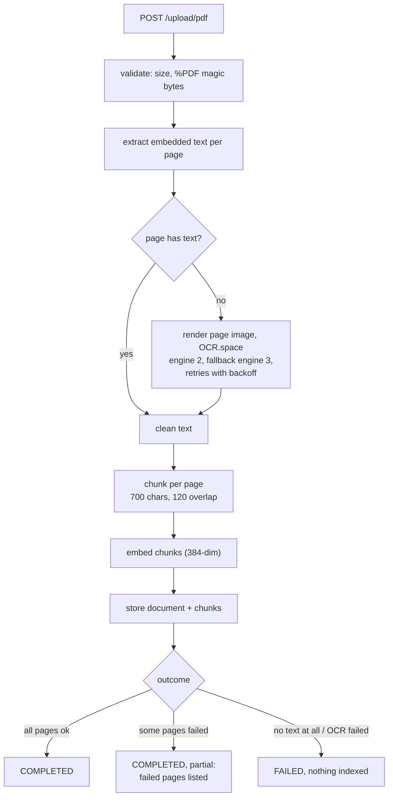

# Agentic AI Chatbot (LangGraph)

A multi-tool AI assistant that routes every question to the right source (the
LLM itself, Wikipedia, the live web, arXiv, your uploaded PDFs or your images)
and streams back a grounded answer with sources and page citations. It has
voice input, saved chat history, user profiles and settings, and an admin panel
protected by server-side roles.

**Stack:** FastAPI · LangGraph / LangChain · Groq · Supabase (Auth, Postgres,
pgvector) · FastEmbed · OCR.space · plain HTML/CSS/JS frontend · Render.

---

## Contents

1. [Overview](#1-overview)
2. [Features](#2-features)
3. [Tech stack](#3-tech-stack)
4. [Architecture](#4-architecture)
5. [Chat request flow](#5-chat-request-flow)
6. [Routing with LangGraph](#6-routing-with-langgraph)
7. [PDF ingestion and OCR](#7-pdf-ingestion-and-ocr)
8. [Retrieval pipeline](#8-retrieval-pipeline)
9. [Citations](#9-citations)
10. [Image understanding](#10-image-understanding)
11. [Voice input](#11-voice-input)
12. [Authentication and sessions](#12-authentication-and-sessions)
13. [Roles and admin access](#13-roles-and-admin-access)
14. [Security model](#14-security-model)
15. [Data model](#15-data-model)
16. [Database migrations](#16-database-migrations)
17. [Project structure](#17-project-structure)
18. [Prerequisites](#18-prerequisites)
19. [Local setup](#19-local-setup)
20. [Environment variables](#20-environment-variables)
21. [Running locally](#21-running-locally)
22. [Frontend pages](#22-frontend-pages)
23. [API reference](#23-api-reference)
24. [Admin panel](#24-admin-panel)
25. [Testing](#25-testing)
26. [RAG evaluation](#26-rag-evaluation)
27. [Deploying on Render](#27-deploying-on-render)
28. [Troubleshooting](#28-troubleshooting)
29. [Known limitations](#29-known-limitations)
30. [Roadmap](#30-roadmap)

---

## 1. Overview

You type (or speak) a question, optionally attaching PDFs or images. The
backend resolves every attachment by ID and checks that you own it. It then
picks a route:

- a PDF attached → **retrieval-augmented generation (RAG)** over that PDF;
- an image attached → **OCR plus a vision model**;
- otherwise an LLM router chooses **Direct**, **Wikipedia**, **Web (Tavily)** or
  **arXiv**.

The answer streams to the browser over Server-Sent Events, together with
progress stages and sources. Conversations, messages and uploads are stored in
Supabase per user.

## 2. Features

- **Smart routing:** a structured-output LLM router picks the best tool for each
  text question.
- **Chat with your PDFs:** text PDFs, scanned PDFs (OCR) and mixed PDFs are
  supported. Hybrid retrieval combines dense and keyword search, and answers
  cite page numbers.
- **Robust OCR:** per-page OCR, only for pages without embedded text. Engine
  fallback, retries with backoff, rate-limit spacing, and partial-success
  reporting when some pages fail.
- **Images:** OCR for text in the image and a vision model for everything else.
- **Voice input:** Whisper transcription with optional auto-send.
- **Streaming UI:** live stages ("Choosing the best route", "Reading text in the
  image", "Writing the answer"), sources and retry.
- **Accounts:** email/password and Google sign-in through Supabase Auth, plus
  profile (display name) and settings (theme, voice language, auto-send,
  change password, log out everywhere, archive all chats).
- **Admin panel:** dashboard, users, documents, images, activity, audit log and
  system health, all behind server-side role checks.
- **Light/dark theme** and a responsive layout down to phone width.

## 3. Tech stack

| Layer | Technology |
|---|---|
| API | FastAPI 0.141, Uvicorn |
| Orchestration | LangGraph 1.2, LangChain Core |
| LLM | Groq `openai/gpt-oss-120b` (router, answers, RAG) |
| Vision | Groq `qwen/qwen3.8-27b` |
| Speech | Groq `whisper-large-v3-turbo` |
| Search tools | Tavily, Wikipedia API, arXiv |
| Embeddings | FastEmbed `sentence-transformers/paraphrase-multilingual-MiniLM-L12-v2` (384 dimensions) |
| Vector store | Supabase Postgres + pgvector |
| Auth | Supabase Auth (supabase-js 2.117.3 in the browser, pinned with SRI) |
| OCR | OCR.space (engines 2 and 3) |
| PDF | PyMuPDF, pypdf |
| Frontend | Plain HTML, CSS and JavaScript, no build step |
| Hosting | Render (no Docker) |

Exact versions are pinned in [`backend/requirements.txt`](backend/requirements.txt).

## 4. Architecture



The browser only holds the public Supabase URL and publishable key, which it
gets from `GET /config`. The server-side secret key, the Groq, Tavily and
OCR.space keys, and every database write stay on the backend.

## 5. Chat request flow



On failure the stream ends with a generic `error` event. Internal details are
logged on the server and never sent to the client.

## 6. Routing with LangGraph



Attachments take priority (`graph/nodes.py`). Text-only questions go to the
structured router in `graph/router.py`, which returns one of `DIRECT`,
`WIKIPEDIA`, `TAVILY` or `ARXIV` with a short reason.

## 7. PDF ingestion and OCR



- Only pages without embedded text are sent to OCR.
- A page counts as `success`, `empty` (OCR worked but found no text) or `failed`.
- If embedding or storage fails, the document is rolled back, so no
  half-indexed document is left behind.
- If the file is deleted while it is being processed, the document is discarded.
- With `?stream=true` the upload returns NDJSON progress events (one per
  stage/page) followed by the result.

## 8. Retrieval pipeline

Implemented in `backend/rag/retrieval/` and run for every PDF question:

1. **Query transform:** classifies the query (specific, list or broad) and
   normalises it.
2. **Hybrid retrieval:** dense search through the `match_document_chunks` RPC
   (pgvector) plus keyword search through the `keyword_document_chunks` RPC,
   20 candidates each, merged.
3. **Rerank:** a lexical reranker keeps 5, 8 or 10 results depending on the
   query type. It uses generic stop words only, so it works for any PDF.
4. **Diversity selection:** avoids near-duplicate chunks.
5. **Context build:** adds neighbouring chunks (window 1), at most 8 to 10
   chunks or 6,000 characters, ordered by document position.

Nothing in the pipeline is specific to any document. The embedding model and
the 384-dimensional schema are fixed in production.

## 9. Citations

Every chunk stores the page it came from. The context sent to the LLM labels
each chunk `[Source N | Page P | Chunk C]`, and the UI shows a source preview
with its page number. Pages that failed OCR are never cited, because nothing is
stored for them. This is covered by `tests/test_pdf_ocr.py` (see
`test_citations_carry_the_source_page`).

## 10. Image understanding

`POST /upload/image` stores the image (owner only). When it is attached to a
question, the backend runs OCR for visible text and the Groq vision model for
everything else, then answers from both. If one of them fails, the answer
still uses the other and says so.

## 11. Voice input

The browser records audio and sends it to `POST /voice/transcribe` (Groq
Whisper). The transcript goes into the input box. If **Send automatically** is
on in Settings, it is sent straight away. The spoken language can be set in
Settings or left on automatic detection.

## 12. Authentication and sessions

- **Supabase Auth is the only credential store.** It handles email/password,
  Google OAuth, email confirmation and password reset. The app never stores
  or checks passwords itself.
- **One session manager:** the `Auth` object in [`frontend/common.js`](frontend/common.js)
  is shared by all pages. It has explicit states: `loading`, `signed-in`,
  `signed-out` and `error`.
  - While it is `loading`, pages show a neutral placeholder. They never flash
    the logged-out UI.
  - If the sign-in service can't be reached, the state becomes `error`, with a
    **Reconnect** button. The stored session is kept.
  - The state is re-synced when a page is restored from the Back/Forward cache.
- **API calls** send the access token as `Authorization: Bearer …`.
  - **401:** the client refreshes once and retries. Concurrent requests share
    one refresh. If the refresh is rejected, the session is ended and the
    sign-in dialog opens with "Your session has expired". If the auth server
    is unreachable, the session is kept and a temporary error is shown.
  - **403:** shows an access error and keeps the session.
  - **503:** shows a temporary error and keeps the session.
- **Backend verification** (`auth/supabase_auth.py`): an invalid or expired
  token gets `401`. If Supabase is unreachable, rate-limited or returns 5xx
  (after 3 attempts), the backend returns `503` with `Retry-After`, never a
  false "logged out".
- **Logout** signs out with Supabase and clears the local session. HTML pages
  are served with `Cache-Control: no-cache`.

## 13. Roles and admin access

Admins use the **same login page** as everyone else. A request is admin only
if **both** of these are true, checked on the backend for every `/admin/*`
endpoint:

1. the account's email is **confirmed** and listed in `ADMIN_EMAIL` (server
   config, comma-separated); and
2. `public.profiles.role = 'ADMIN'` for that user.

Notes:

- Normal users get `403`. A missing profile row means "not admin".
- If the role can't be read (a database outage), the request gets `503`, never
  a wrong yes or no.
- Supabase `app_metadata.role` is **ignored**.
- `ADMIN_EMAIL` is not a secret. It is an allowlist: changing the role in the
  database alone is not enough to become admin.
- There is **no admin password** anywhere in the app, `.env`, SQL or frontend.

To grant the role, an operator runs one of these on a trusted machine:

```bash
cd backend
python -m scripts.grant_admin            # show current state, change nothing
python -m scripts.grant_admin --grant    # set profiles.role = 'ADMIN' for ADMIN_EMAIL accounts
python -m scripts.grant_admin --revoke   # set it back to 'USER'
```

Or run this in the Supabase SQL editor:

```sql
update public.profiles set role = 'ADMIN'
where id = (select id from auth.users where email = '<admin email>');
```

The script never creates accounts or profile rows and never touches passwords.
Migration `20261010_protect_profile_role.sql` stops anyone from changing
`role` from the browser.

## 14. Security model

- **Every API route** except `/health` and `/config` requires a verified
  Supabase token. Admin routes also require the admin role.
- **No IDOR:** conversations, messages, documents, files and images are always
  filtered by the caller's `user_id`. Attachments are resolved by ID and
  ownership on the server, and the server never accepts a filesystem path from
  the browser.
- **Uploads:** size limits (`MAX_*_MB`), PDF magic-byte check, UUID-prefixed
  sanitized file names, and deletion confined to `backend/uploads/`.
- **Secrets stay on the server.** The browser only receives the publishable
  key. `.env` is git-ignored, and `.env.example` contains placeholders only.
- **Database:** Row Level Security stays enabled. The logging tables have RLS
  with no policies, so only the backend can use them.
- **Prompt injection:** RAG, OCR, vision and search prompts tell the model to
  treat retrieved or extracted text as untrusted content and not to follow
  instructions inside it.
- **Output:** markdown is HTML-escaped before rendering, and only `http(s)`
  links are rendered.
- **Headers:** `X-Content-Type-Options: nosniff`, `X-Frame-Options: DENY`,
  `Referrer-Policy: strict-origin-when-cross-origin`.
- **CORS:** off by default and enabled only for `ALLOWED_ORIGINS`.
- **Production** (`APP_ENV=production`) disables `/docs` and `/openapi.json`.
- **Timeouts** are set on all external calls: Groq (`GROQ_TIMEOUT_S`),
  OCR.space, Supabase HTTP and Wikipedia.
- **Errors:** unexpected errors return a generic message, and details go to the
  server log only. Logs never contain tokens or keys.

## 15. Data model

Tables in the `public` schema that the backend uses:

| Table | Purpose |
|---|---|
| `profiles` | display name, avatar, `role` (`USER` / `ADMIN`) |
| `conversations` | per-user chats (soft-archived on delete) |
| `messages` | user and assistant messages, route, sources |
| `files` | uploaded files (PDF / image) and their owner |
| `documents` | processed PDFs and their `processing_status` |
| `document_chunks` | chunk text, `page_number`, `chunk_index`, `embedding vector(384)` |
| `images` | image analysis records |
| `audio_files` | voice transcription records |
| `activity_logs` | voice use and failed requests/uploads (migration 20261008) |
| `admin_audit_log` | every destructive admin action (migration 20261008) |

RPCs: `match_document_chunks` (vector search) and `keyword_document_chunks`
(keyword search).

## 16. Database migrations

SQL files in [`supabase/migrations/`](supabase/migrations/) are run once, in
order, in the Supabase SQL editor. Each is idempotent and forward-only.

| File | What it does |
|---|---|
| `20261008_activity_logging.sql` | `activity_logs` and `admin_audit_log` tables (RLS on, no policies) |
| `20261009_profiles_backend_access.sql` | lets the backend role read and write `profiles` |
| `20261010_protect_profile_role.sql` | trigger: `profiles.role` can't be changed (or set to anything but `USER` on insert) except by trusted server roles |

The app runs without `20261008`, but the admin panel then shows only data
from the core tables.

## 17. Project structure

```
backend/
  main.py                 FastAPI app: pages, chat (SSE), uploads, voice, conversations
  account/routes.py       /profile/me (own profile and usage)
  admin/routes.py         /admin/* (admin only)
  auth/supabase_auth.py   token verification, admin rule, 401/403/503 mapping
  config/settings.py      environment configuration
  database/connection.py  shared Supabase client (thread-safe HTTP/1.1 pool)
  graph/                  LangGraph state, router, nodes, workflow
  agents/ tools/ prompts/ tool agents, external tools, prompt templates
  rag/
    ingestion/            PDF text extraction, OCR, cleaning
    chunking/             sentence-aware chunker
    embeddings/           FastEmbed model (384-dim)
    retrieval/            dense, keyword, hybrid, rerank, diversity, context
    query/                query classification and transform
    evaluation/           offline RAG evaluation tools and datasets
    pipeline.py           ingestion orchestration and outcomes
  services/               storage, file ownership, activity log, image analysis
  scripts/grant_admin.py  grant or revoke the admin role
  scripts/manual/         manual live-API smoke scripts (not unit tests)
  tests/                  unittest suites (all external services mocked)
frontend/
  index.html  app.js      chat
  profile.html profile.js profile
  settings.html settings.js settings
  admin.html  admin.js    admin panel
  about.html              about page
  common.js               shared auth/session, API client, UI helpers
  style.css pages.css admin.css about.css
  assets/                 logo and icons
supabase/migrations/      SQL migrations (run in the Supabase SQL editor)
```

## 18. Prerequisites

- Python 3.13 (tested with 3.13.15)
- A Supabase project with Auth enabled and the tables and RPCs listed in
  [§15](#15-data-model)
- API keys for Groq, Tavily and OCR.space
- Optional: Google OAuth configured in Supabase Auth

## 19. Local setup

```bash
cd backend
python -m venv .venv
.venv\Scripts\activate            # Windows
# source .venv/bin/activate       # macOS / Linux
pip install -r requirements.txt
copy .env.example .env            # Windows (macOS/Linux: cp .env.example .env)
```

Fill in `backend/.env` (see [§20](#20-environment-variables)), then run the
migrations from [§16](#16-database-migrations) in the Supabase SQL editor.

In Supabase Auth → URL configuration, add your site URL (for example
`http://127.0.0.1:8000`) and the production URL as redirect URLs.

## 20. Environment variables

Defined in `backend/.env` (never committed). The template is
[`backend/.env.example`](backend/.env.example).

| Variable | Required | Description |
|---|---|---|
| `GROQ_API_KEY` | yes | Groq API key (LLM, vision, Whisper) |
| `TAVILY_API_KEY` | yes | Tavily web search |
| `SUPABASE_URL` | yes | `https://<project-ref>.supabase.co` |
| `SUPABASE_KEY` | yes | **server-side secret key**, backend only |
| `SUPABASE_PUBLISHABLE_KEY` | yes | public key sent to the browser for sign-in |
| `OCR_SPACE_API_KEY` | for scanned PDFs / images | OCR.space key |
| `ADMIN_EMAIL` | for admin | comma-separated admin allowlist (not a secret) |
| `APP_ENV` | no | `development` (default) or `production` |
| `APP_VERSION` | no | shown in the admin panel |
| `ALLOWED_ORIGINS` | no | CORS origins, only if the frontend is served elsewhere |
| `MAX_PDF_MB` / `MAX_IMAGE_MB` / `MAX_AUDIO_MB` | no | upload limits (25 / 10 / 25) |
| `GROQ_TIMEOUT_S` / `GROQ_MAX_RETRIES` | no | Groq request timeout and retries (60 / 2) |
| `OCR_SPACE_ENGINE` / `OCR_SPACE_FALLBACK_ENGINE` | no | OCR engines (2 / 3) |
| `OCR_SPACE_LANGUAGE` / `OCR_SPACE_FALLBACK_LANGUAGE` | no | OCR language (`auto`) |
| `OCR_MAX_ATTEMPTS` | no | attempts per page, alternating engines (4) |
| `OCR_RETRY_BASE_DELAY_S` / `OCR_RETRY_MAX_DELAY_S` | no | backoff (1.0 / 8.0) |
| `OCR_CONNECT_TIMEOUT_S` / `OCR_READ_TIMEOUT_S` | no | OCR timeouts (10 / 90) |
| `OCR_SPACE_MIN_INTERVAL_S` | no | spacing between OCR requests (0.5) |
| `OCR_RENDER_DPI` / `OCR_SPACE_MAX_UPLOAD_BYTES` | no | page rendering (150 / 1000000) |

## 21. Running locally

```bash
cd backend
uvicorn main:app --reload
```

| URL | Page |
|---|---|
| http://127.0.0.1:8000/ | Chat |
| http://127.0.0.1:8000/profile | Profile |
| http://127.0.0.1:8000/settings | Settings |
| http://127.0.0.1:8000/about | About |
| http://127.0.0.1:8000/admin | Admin panel (admins only) |
| http://127.0.0.1:8000/docs | API docs (development only) |

The first start downloads the embedding model, so it is slower.

## 22. Frontend pages

All pages share `common.js` (session, API client, user menu, toasts) and
`style.css` (design tokens, light/dark theme). Static assets are
cache-busted with `?v=<version>`.

| Page | What it does |
|---|---|
| Chat (`/`) | conversation sidebar, streaming answers, attachments (PDF/image), voice, sources, retry |
| Profile (`/profile`) | display name, account details, usage counts |
| Settings (`/settings`) | theme, voice language and auto-send, sign-in method, change password, log out everywhere, archive all chats |
| About (`/about`) | how the assistant works |
| Admin (`/admin`) | dashboard, users, documents, images, activity, audit log, system health |

## 23. API reference

All endpoints except `/health`, `/config` and the HTML pages need
`Authorization: Bearer <Supabase access token>`.

| Method | Path | Description |
|---|---|---|
| GET | `/health` | liveness check |
| GET | `/config` | public sign-in config (Supabase URL and publishable key) |
| GET | `/auth/me` | current user and admin flag (`null` if the role can't be read right now) |
| POST | `/chat` | non-streaming chat |
| POST | `/chat/stream` | streaming chat (SSE: `status`, `route`, `content`, `sources`, `done`, `error`) |
| POST | `/upload/pdf` | upload and index a PDF (`?stream=true` for NDJSON progress) |
| POST | `/upload/image` | upload an image |
| GET | `/files/{file_id}/content` | download your own file |
| DELETE | `/files/{file_id}` | delete your own file |
| POST | `/voice/transcribe` | speech to text |
| GET | `/conversations` | list your conversations |
| POST | `/conversations` | create a conversation |
| POST | `/conversations/archive-all` | archive all your conversations |
| GET | `/conversations/{id}/messages` | messages of your conversation |
| DELETE | `/conversations/{id}` | archive your conversation |
| GET / PATCH | `/profile/me` | your profile (only `full_name` can be changed) |
| GET | `/admin/me` | admin check |
| GET | `/admin/dashboard` | totals and recent activity |
| GET | `/admin/users`, `/admin/users/{id}` | users |
| DELETE | `/admin/users/{id}` | delete a user (audited) |
| GET | `/admin/activity`, `/admin/searches`, `/admin/chat-activity` | activity |
| DELETE | `/admin/activity/{log_id}` | delete an activity entry (audited) |
| GET | `/admin/audit-log` | admin audit trail |
| GET / DELETE | `/admin/documents`, `/admin/documents/{id}` | documents |
| GET / DELETE | `/admin/images`, `/admin/images/{id}` | images |
| GET | `/admin/system-health` | dependency checks |
| GET | `/admin/settings` | non-secret configuration (environment, models, limits) |

## 24. Admin panel

`/admin` loads for everyone, but its data comes only from `/admin/*`
endpoints, and those endpoints enforce the admin rule from
[§13](#13-roles-and-admin-access). Other users see one of these gates instead:

- "Access denied" (403);
- "Please log in";
- "Can't check your access right now" (503).

Destructive actions ask for confirmation and are written to `admin_audit_log`.
Statistics come from the real tables; nothing is estimated or invented.

## 25. Testing

```bash
cd backend
python -m unittest discover -s tests -v
```

| Suite | Covers |
|---|---|
| `tests/test_auth.py` | token verification, 401 vs 503 mapping, admin rule, `/auth/me` |
| `tests/test_security.py` | auth on every route, IDOR protection, admin 403/503, uploads, error hiding |
| `tests/test_pdf_ocr.py` | text / scanned / mixed PDFs, OCR retries and fallbacks, partial success, rollback, page citations, upload streaming |
| `tests/test_attachments_profile.py` | attachment ownership, profile endpoints |

Groq and OCR.space are always **mocked** (no credits used), and so are almost
all Supabase calls. Three tests are **read-only live checks** against the
Supabase project in `backend/.env`, so they need network access:

- an invalid token is rejected with 401;
- unknown file IDs return 404;
- the `ADMIN_EMAIL` account exists and is confirmed (skipped when
  `ADMIN_EMAIL` is empty).

None of them writes data. `scripts/manual/` holds optional live smoke scripts
that call the real APIs.

## 26. RAG evaluation

Offline evaluation tools live in `backend/rag/evaluation/`, with question
sets in `datasets/`:

```bash
cd backend
python -m rag.evaluation.evaluator --document-id <document id> --dataset my_pdf.json
```

[`PHASE14_REPORT.md`](backend/rag/evaluation/PHASE14_REPORT.md) records the
embedding benchmark that led to keeping the current 384-dim model.

## 27. Deploying on Render

Create a **Web Service** (no Docker):

| Setting | Value |
|---|---|
| Root directory | `backend` |
| Build command | `pip install -r requirements.txt` |
| Start command | `uvicorn main:app --host 0.0.0.0 --port $PORT` |
| Environment | every variable from [§20](#20-environment-variables), plus `APP_ENV=production` |

Also:

- Add the Render URL to Supabase Auth → URL configuration (site URL and
  redirect URLs), and to Google OAuth if you use it.
- Uploaded files are stored under `backend/uploads/`. Render's disk is
  ephemeral, so attach a persistent disk at that path if files must survive
  redeploys. PDF chunks live in Supabase either way.
- The first request after a deploy is slower while the embedding model
  downloads.

## 28. Troubleshooting

| Symptom | Cause / fix |
|---|---|
| "We couldn't reach the sign-in service" | Supabase Auth or `/config` unreachable. Your session is kept; use **Reconnect**. |
| "Your session has expired" | the refresh token was rejected. Sign in again. |
| Admin page says "Access denied" | the email isn't in `ADMIN_EMAIL`, isn't confirmed, or `profiles.role` isn't `ADMIN` (see [§13](#13-roles-and-admin-access)) |
| A PDF upload says some pages are unreadable | OCR failed for those pages after all retries. The rest is indexed. Re-upload later to retry. |
| "This PDF has no readable text" | the PDF has no embedded text and OCR found none (for example blank pages) |
| Backend can't start on Windows: `mmh3` DLL blocked | Smart App Control blocks `mmh3.pyd` (a FastEmbed dependency). Allow it, or run on Linux/Render. |
| `ValueError: GROQ_API_KEY is missing` | `backend/.env` isn't filled in |

## 29. Known limitations

- Uploads are stored on local disk (see [§27](#27-deploying-on-render)).
- The browser uses Supabase's implicit OAuth flow. PKCE would be stricter but
  needs email links opened in the same browser.
- Server logs include user queries for debugging. Treat logs as personal data.
- The RAG reranker is lexical, not a cross-encoder (see the Phase 14 report).

## 30. Roadmap

- Switch Supabase Auth to the PKCE flow.
- Move uploads to Supabase Storage.
- Add an automated browser test suite (Playwright) for the auth and session
  flows.
- Add query logging levels so production logs can omit user content.
